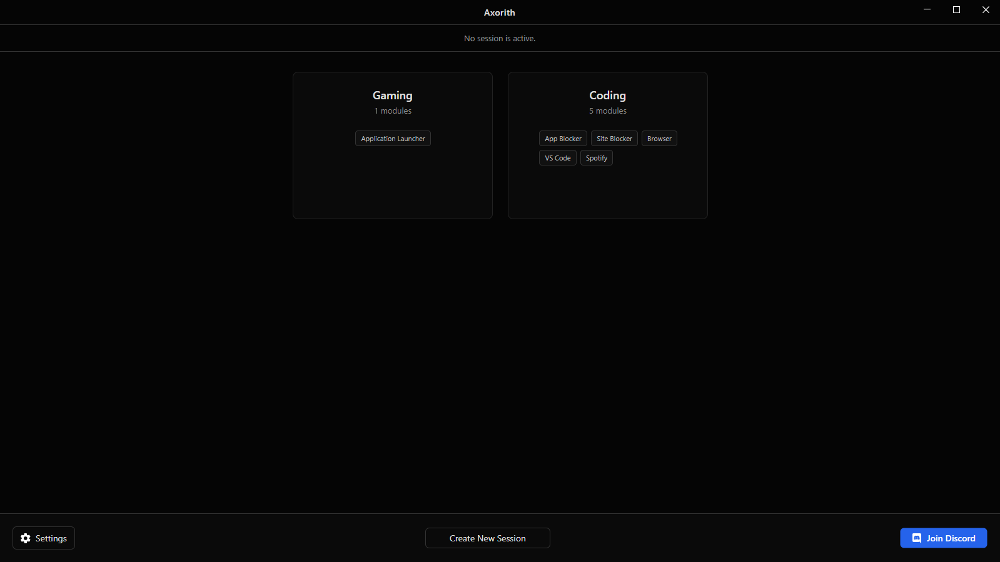
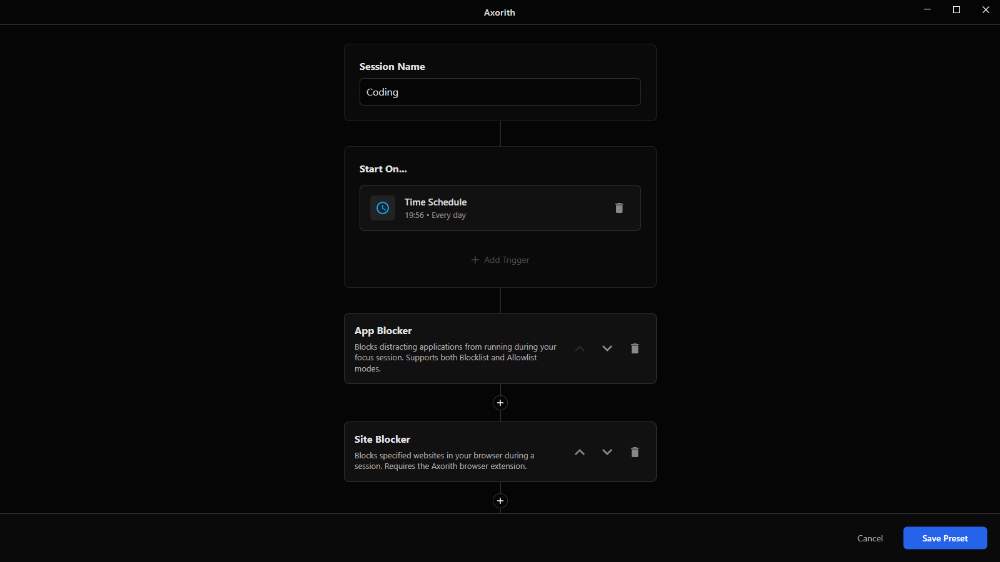
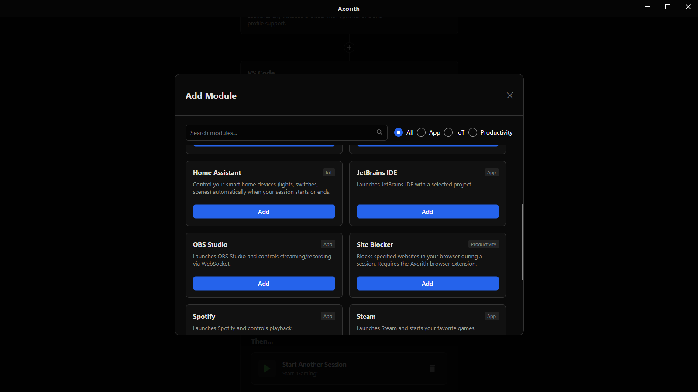
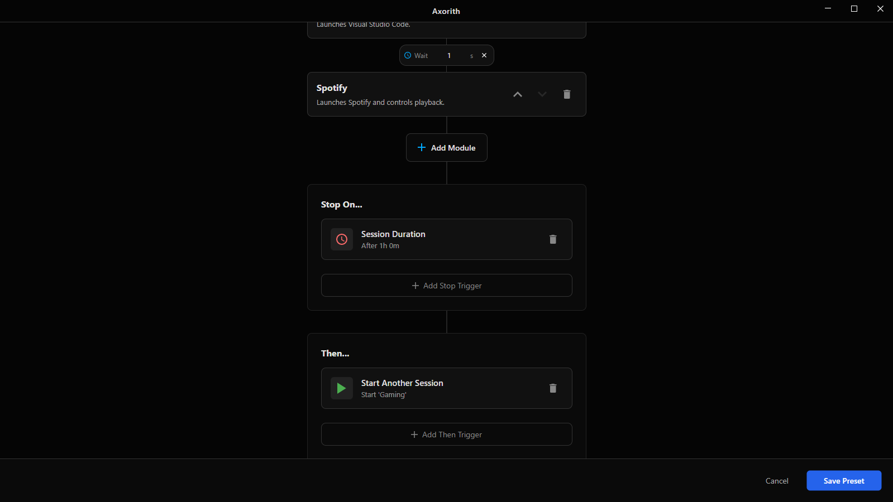

# Axorith

**Workspace automation, app and website blocking, and scheduled focus sessions for Windows.**

Axorith lets you configure your desktop environment once and reuse it whenever you need it. Create a Workspace with the applications you want to open, distractions you want to block, and actions you want to run. Start it manually, schedule it, or switch to another Workspace when a session ends.

It combines application launching, focus controls, scheduling, and optional integrations in a local Windows application.

[**Download for Windows**](https://github.com/axorithlabs/axorith/releases/latest) · [**Website**](https://axorith.com) · [**Report an issue**](https://github.com/axorithlabs/axorith/issues) · [**Discussions**](https://github.com/axorithlabs/axorith/discussions)


Axorith is free for personal, educational, and non-commercial use. Its source code is available under the Business Source License 1.1.

## What Axorith does

A Workspace is a reusable configuration for a particular activity, such as programming, studying, writing, or gaming.

For example, a programming Workspace can open VS Code with your project, block selected games and websites, start music, and run for a defined period. A schedule can activate it automatically. Once the session ends, Axorith can stop its modules or start another Workspace.

You choose which actions and restrictions each Workspace contains.

### Features

| Feature               | What it does                                                                                                 |
| --------------------- | ------------------------------------------------------------------------------------------------------------ |
| Workspaces            | Save reusable combinations of apps, blocking rules, schedules, and session settings.                         |
| Application Launcher  | Open supported applications or custom executables with configurable launch options.                          |
| App Blocker           | Block selected Windows applications or restrict running applications to a configured allowlist.              |
| Site Blocker          | Block selected websites or allow only specified sites in supported browsers using a companion extension.     |
| Scheduler             | Start Workspaces at configured times and stop sessions after a specified duration.                           |
| Focus Commitment      | Choose how strictly a session can be interrupted, configure permitted breaks, and define its end conditions. |
| Workspace chaining    | Start another Workspace automatically after the current one ends.                                            |
| Integrations          | Control supported applications and Home Assistant devices as part of a session.                              |
| Local background Host | Keep session execution separate from the desktop user interface.                                             |
| Module SDK            | Extend Axorith with additional modules using the C# SDK.                                                     |

## Examples

These examples illustrate configurations you can create with the available modules and session settings. They are not built-in templates.

### Programming

Create a Workspace called `Coding`.

Configure Application Launcher to open VS Code or a JetBrains IDE, optionally with a specific project. Use App Blocker to restrict distracting applications and Site Blocker to block selected websites.

Set a two-hour session if you want the Workspace to stop automatically, or use Focus Commitment when you want restrictions on ending it early.

### Studying

Create a Workspace called `Study`.

Open the applications needed for the subject, block distracting websites, and schedule the session for a regular study period. Configure allowed breaks if using a committed session.

The applications and restrictions can differ from those used in your programming Workspace.

### Switching between work and leisure

Create separate `Work` and `Rest` Workspaces.

Use the Scheduler to start Work at a selected time. Configure the end behavior to activate Rest after Work finishes. The Rest Workspace can launch different applications and use different module settings.

### Smart home automation

Add the Home Assistant module to a Workspace to control configured lights, switches, scenes, or scripts when sessions start or end.

This requires an existing Home Assistant installation and a configured connection.

## Getting started

### Requirements

Axorith is currently a **Windows desktop application**. Its modules and system integrations are designed for Windows.

Linux and macOS are not currently supported release platforms.

Some integrations have additional requirements. For example, Site Blocker requires a companion browser extension, Spotify requires access to Spotify, and Home Assistant requires a configured Home Assistant server.

### Install

1. Download the Windows installer from [GitHub Releases](https://github.com/axorithlabs/axorith/releases/latest).
2. Run the installer.
3. Open Axorith and create your first Workspace.
4. Add the applications or blocking modules you want.
5. Save the Workspace and start it.

Windows SmartScreen may display a reputation warning for an unsigned build. Download Axorith only from its official release page and review the source if you need to verify what you are installing.

The latest published release may not include every change currently present in the repository.

### Create a Workspace

Open the Workspace editor and configure its behavior.

**Focus Commitment:** Select the commitment mode and, when applicable, its end condition, permitted breaks, and action after completion.

**Start On:** Add a schedule to start the Workspace automatically, or leave scheduling unconfigured to start it manually.

**Modules:** Use the module picker to add Application Launcher, App Blocker, Site Blocker, or other available modules.

**Stop On:** Configure a duration-based stop when you want an automatically ending session.

**After the session:** Optionally start another Workspace or choose another supported end action.

Save the configuration and start the Workspace from the dashboard.

## Application and website blocking

### App Blocker

App Blocker controls which applications can run while a session is active.

It supports two modes:

- **Blocklist:** Restrict selected applications or categories.
- **Allowlist:** Restrict running applications to the applications configured for the Workspace.

Application blocking is enforced through Windows process control. Its effectiveness depends on the selected configuration and available system permissions.

### Site Blocker

Site Blocker restricts website access in supported browsers.

It supports blocking specified sites or allowing only configured sites.

Browser-specific website blocking requires the Axorith companion extension and its connection to the local application.

The project includes browser extension code for Chromium-based browsers and Firefox under `src/Modules/SiteBlocker/BrowserExtension`.

Site Blocker is not a system-wide network firewall. Its protection applies through its supported browser integration and configured fallback behavior.

## Focus Commitment

Focus Commitment controls how a session can be ended or interrupted.

Axorith implements three modes:

**Normal:** Standard session behavior with ordinary user control.

**Locked:** Committed-session behavior that restricts ordinary manual stopping until the configured end condition.

**Strict:** Stronger Windows-specific protection for committed sessions. Strict mode requires the necessary Windows protection mechanisms to be available and enabled.

Committed sessions can use a fixed duration or configured ending time. They can also include a defined number of permitted breaks, an optional configuration lock before a scheduled start, and a selected action after completion.

Available end actions include starting another Workspace, locking the PC, sleep, sign-out, and shutdown.

Strict protection is subject to Windows and application limitations. Axorith does not claim to make a computer impossible to bypass, disable, or recover.

## Supported modules and integrations

### Application Launcher

Application Launcher supports custom executable configurations and application-specific options.

The repository includes integrations for browsers, VS Code, JetBrains IDEs, Discord, Spotify, Steam, and OBS.

Available options depend on the selected application. These can include project paths, startup arguments, window behavior, application lifecycle actions, and application-specific settings.

### Home Assistant

The Home Assistant module communicates with a configured Home Assistant instance to control supported entities during session start and end.

It can be used to change the physical environment alongside a digital Workspace.

### Spotify, Steam, and OBS

Application-specific integrations provide additional automation options, such as Spotify playback configuration, Steam game launching, and OBS actions.

These integrations may require external applications, accounts, services, or locally running APIs. Their availability depends on the configured environment.

## How Axorith works

Axorith separates the user interface from session execution.

The principal components are:

| Component           | Responsibility                                                                      |
| ------------------- | ----------------------------------------------------------------------------------- |
| `Axorith.Client`    | Avalonia desktop UI for managing Workspaces and sessions.                           |
| `Axorith.Host`      | Background process that manages session execution and communicates with the Client. |
| `Axorith.Core`      | Session management, module loading, scheduling, and execution logic.                |
| `Axorith.Contracts` | Communication contracts, including Protobuf definitions.                            |
| `Axorith.Sdk`       | Interfaces and settings contracts used to develop modules.                          |
| `Axorith.Shim`      | Native messaging integration for browser communication.                             |

Client and Host communicate locally using gRPC.

The Host manages active session state independently from the Client window. This allows session execution to continue when the interface is closed or restarted, subject to the Host remaining operational.

### Technology

Axorith uses C# 14, .NET 10, Avalonia UI, ReactiveUI, gRPC/Protobuf, and Serilog.

Modules use .NET assembly loading mechanisms, including `AssemblyLoadContext`, to support modular discovery and lifecycle management.

## Module development

Axorith provides a C# SDK for developing additional Workspace modules.

A module describes its metadata in `module.json` and implements the `IModule` contract.

The interface includes settings, user-invokable actions, validation, session-start behavior, session-end behavior, and optional initialization.

The main development entry points are:

- `IModule`: Module lifecycle contract.
- `ModuleDefinition`: Metadata defined by `module.json`.
- `Settings`: Reactive module setting contracts and implementations.
- `Actions`: Module action contracts.
- `ModuleLoader`: Module discovery and loading.
- `Existing modules`: Real implementation examples.

For working examples, examine the App Blocker, Application Launcher, and Home Assistant source directories.

Module constructors should remain lightweight. The SDK provides initialization and session lifecycle methods for operations that require resources or perform work.

The module SDK is a development interface. A public plugin marketplace is not required to build or use the bundled modules.

## Build from source

Development currently targets Windows and requires the .NET 10 SDK.

Clone the repository and open `Axorith.sln` in a compatible .NET IDE, or use the .NET command-line tools.

```
git clone https://github.com/axorithlabs/axorith.git
cd axorith

$env:AVALONIA_TELEMETRY_OPTOUT = "1"

dotnet restore Axorith.sln
dotnet build Axorith.sln -c Debug
dotnet test Axorith.sln -c Debug
```

These commands build and test the source tree. Creating a distributable installer uses the separate Windows packaging scripts under `installer/windows`.

Build and runtime requirements for individual modules or integrations may differ from the base solution.

## Privacy and local operation

Workspace configuration, scheduling, and session execution are managed by the local application and background Host.

Axorith is not a cloud-hosted workspace execution service. However, local execution does not mean the application never makes network requests.

Configured integrations such as Spotify and Home Assistant can communicate with their respective services.

Axorith also includes product usage telemetry, enabled by default and configurable in Settings. Telemetry can include a pseudonymous installation identifier, application and OS versions, session and module events, selected configuration details, and sanitized error information.

Tokens and passwords are excluded from the application telemetry payloads. Refer to the telemetry explanation in the application Settings for the current data categories and controls.

## Frequently asked questions

### Is Axorith an app blocker or a workspace automation tool?

Both. It can block Windows applications and websites while also launching applications, executing configured module actions, managing sessions, and switching Workspaces.

### Can I use it without a fixed schedule?

Yes. Workspaces can be started manually. Scheduling is optional.

### Can I automate a sequence of Workspaces?

Yes. Axorith supports starting another Workspace when a session ends, according to its configured end behavior.

### Does Axorith work across all my devices?

No. The desktop application currently runs on Windows. Home Assistant integration allows it to interact with configured smart home entities, but this is not general-purpose cross-device management.

### Is Axorith open source?

Axorith is **source-available**, licensed under the Business Source License 1.1. It is not currently licensed under an OSI-approved open-source license.

## Screenshots

<details>
<summary>View application screenshots</summary>
<table style="width: 100%;">
<tr>
<td></td>
<td></td>
</tr>
<tr>
<td></td>
<td></td>
</tr>
</table>
</details>

## Contributing

Bug reports, feature proposals, documentation improvements, and code contributions are welcome.

Before contributing, read CONTRIBUTING.md and the Code of Conduct.

Use [GitHub Issues](https://github.com/axorithlabs/axorith/issues) for bugs and concrete requests. Use [Discussions](https://github.com/axorithlabs/axorith/discussions) for questions and broader ideas.

Contributions are subject to the repository's license and contribution requirements.

## License

Axorith is distributed under the **Business Source License 1.1 (BSL 1.1)**.

The repository license permits personal, educational, and non-commercial use, modification, and distribution. Commercial use, including resale, SaaS, and integration into paid products, requires explicit written permission from Axorith Labs.

The specified Change Date is **December 31, 2030**, after which the licensed work is designated to change to **Apache License 2.0**, according to the terms of LICENSE.md.

Read the full license before modifying, redistributing, or integrating the software.

## Support development

Axorith is independently developed. If you find it useful and want to support continued development, you can make a voluntary contribution through:

<details>
<summary>Cryptocurrency contributions</summary>

BTC: `bc1q4p93zvy3pxdf293hwka2tmdyhr53zwju3xmwlf`

ETH / USDT / USDC (ERC-20): `0xb1aec06166336cf717b244dbdc8620820824f1d7`

TON: `UQAMfKB_qmJZp2CpIJb6oxrqH4cqe81H2iZ4Mbq9wrR7mHn1`

</details>

## Development tools

[PVS-Studio](https://pvs-studio.com/en/pvs-studio/) provides static analysis tooling for C, C++, C#, and Java.
